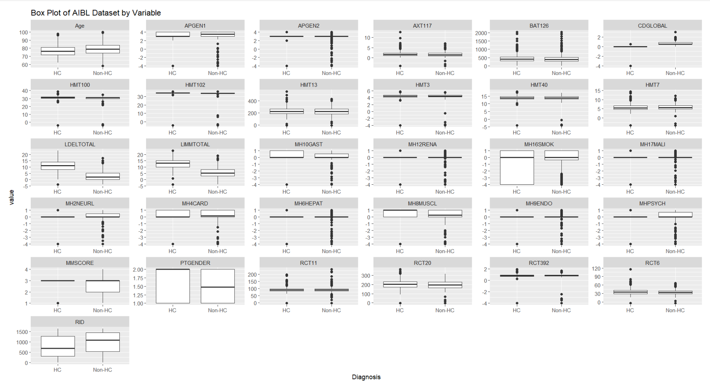
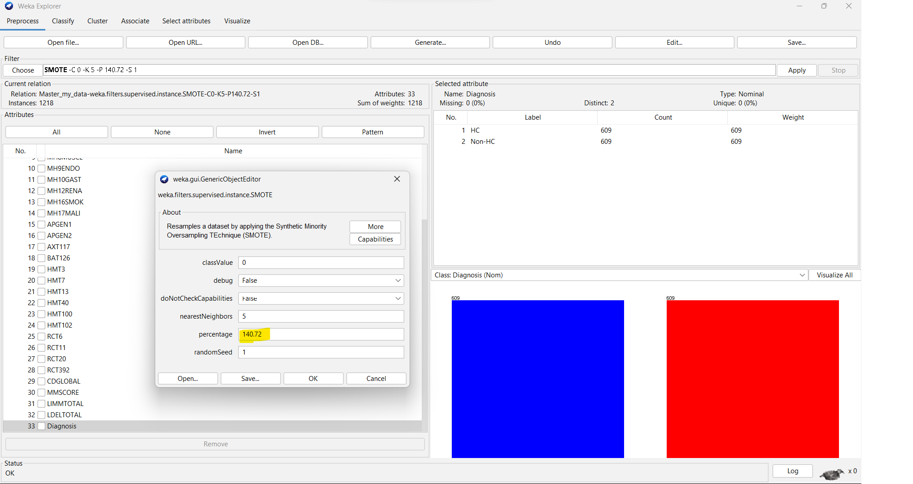

# Alzheimer's Diagnosis Classification (AIBL Dataset)

University coursework (MSc Data Science, Ulster University) applying supervised machine
learning to classify participants from the **AIBL study** (Australian Imaging, Biomarker &
Lifestyle Study of Ageing) as **Healthy Control (HC)** or **Non-HC** (Mild Cognitive
Impairment or Alzheimer's Disease, merged into a single class).

## Overview

- **Language / tools:** R — `tidyverse`, `caret`, `randomForest`, `kernlab`, `e1071`, `class`, `neuralnet`, `NeuralNetTools`
- **Task:** Binary classification (HC vs Non-HC) from clinical, demographic and blood
  biomarker features
- **Report:** [`analysis-report.html`](./analysis-report.html) — full rendered output including
  all model summaries and confusion matrices
- **Source:** [`analysis.Rmd`](./analysis.Rmd) — the R Markdown notebook

## Data

The dataset used is participant-level clinical data from the AIBL study, which is released
under a data use agreement that does not permit redistribution. **The raw/processed dataset
is not included in this repository** — only the code and the rendered analysis report (which
contains summary statistics and model outputs, not raw patient records).

Input features included demographics (age, gender), medical history flags (psychiatric,
neurological, cardiac, hepatic, muscular, endocrine, gastric, renal, smoking, malignancy),
genotype markers, blood biomarkers, and cognitive scores (MMSE, logical memory).

## Pipeline

1. **Preprocessing** — merged MCI and AD labels into a single "Non-HC" class; removed
   duplicates and missing values
2. **Feature engineering** — binned MMSE cognitive scores into severity categories
   (severe / modest / early / normal)
3. **Class balancing** — applied SMOTE (via Weka) to address class imbalance
4. **Exploratory analysis** — boxplots of all features by diagnosis group
   ([`boxplot.png`](./boxplot.png)); SMOTE balance check ([`smote-result.png`](./smote-result.png))
5. **Feature selection** — Recursive Feature Elimination (RFE) with random forest, plus
   correlation-based filtering (cutoff 0.5) to remove redundant features
6. **Modelling** — 70/30 train/test split with feature scaling, then trained:
   - k-Nearest Neighbours (k = 5)
   - Random Forest (500 trees)
   - Support Vector Machine (RBF kernel)

## Exploratory Analysis

### Feature distributions by diagnosis

### Class balance after SMOTE

## Results

| Model | Accuracy |
|---|---|
| k-Nearest Neighbours | 93.96% |
| Random Forest | 88.46% |
| SVM (RBF) | 93.68% |

Full confusion matrices, sensitivity/specificity and 95% CIs for each model are in
[`analysis-report.html`](./analysis-report.html).

## Notes

- This was an individual coursework submission; code and write-up are the author's own work.
- Reproducing the analysis requires access to the AIBL dataset under its own data use
  agreement — it is not provided here.
