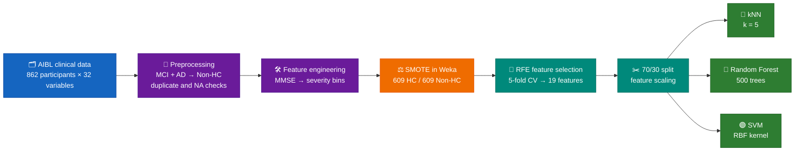
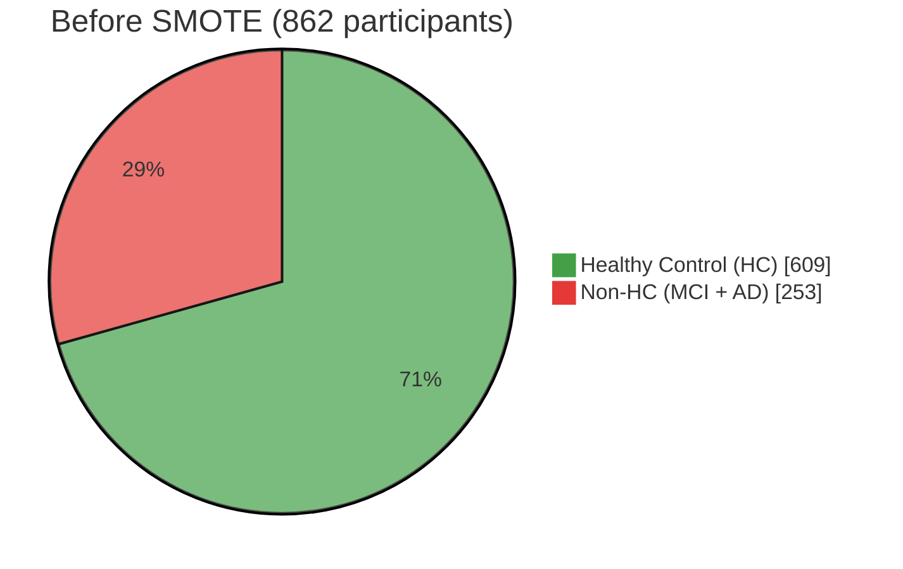

<h1 align="center">🧠 Alzheimer's Diagnosis Classification</h1>

<p align="center">
  <i>Healthy Control vs cognitive impairment on the AIBL study — kNN · Random Forest · SVM in R</i>
</p>

<p align="center">
  
  
  
  
  
</p>

<p align="center">
  
  
  
</p>

---

## 🎯 At a glance

| | |
|---|---|
| 🔬 **Question** | Can clinical, demographic and blood-biomarker data separate healthy controls from people with MCI or Alzheimer's? |
| 🧪 **Classes** | 🟢 **HC** (Healthy Control) vs 🔴 **Non-HC** (Mild Cognitive Impairment + Alzheimer's merged) |
| 📦 **Data** | AIBL study, 862 participants × 32 variables → 1,218 rows after SMOTE balancing |
| 🤖 **Models** | k-Nearest Neighbours · Random Forest · Support Vector Machine (RBF) |
| 🏆 **Best result** | **kNN at 93.96% accuracy** (SVM close behind at 93.68%) |
| 📄 **Report** | [`analysis-report.html`](./analysis-report.html) (rendered output) · [`analysis.Rmd`](./analysis.Rmd) (source) |

---

> [!WARNING]
> **Data is not included.** AIBL participant-level data is released under a data use agreement that prohibits redistribution. This repo contains only the code and the rendered report (summary statistics and model outputs, no raw patient records).

---

## 🔄 Pipeline



1. **Preprocessing** — merged MCI and AD into a single *Non-HC* class; checked for missing values (none) and removed duplicates.
2. **Feature engineering** — binned MMSE cognitive scores into severity categories (severe / modest / early / normal).
3. **Class balancing** — applied SMOTE in Weka to fix the class imbalance.
4. **Exploratory analysis** — boxplots of every feature by diagnosis group.
5. **Feature selection** — Recursive Feature Elimination (random-forest functions, 5-fold CV) picked 19 of the original features. A correlation filter (cutoff 0.5) was also explored, but the final models use the RFE feature set.
6. **Modelling** — 70/30 train/test split (854 / 364 rows), features standardised, then three classifiers trained and compared.

### ⚖️ Class balance



After SMOTE the minority class was oversampled so both classes have **609** rows (**1,218** in total), and the test set is perfectly balanced at 182 / 182.

### 🧬 Features selected by RFE (19)

| Group | Features |
|---|---|
| 🧠 Cognitive and clinical scores | `CDGLOBAL` · `MMSCORE` · `LDELTOTAL` · `LIMMTOTAL` |
| 🧬 Genotype | `APGEN1` |
| 🏥 Medical history | `MHPSYCH` · `MH2NEURL` · `MH8MUSCL` · `MH9ENDO` · `MH16SMOK` |
| 🩸 Blood / lab measures | `HMT7` · `HMT40` · `HMT102` · `RCT6` · `RCT20` · `RCT392` · `BAT126` |
| 👤 Demographics / ID | `PTGENDER` · `RID` ⚠️ *(see limitations)* |

---

## 📊 Exploratory analysis

<p align="center">
  <b>Feature distributions by diagnosis group</b><br>
  
</p>

<p align="center">
  <b>Class balance after SMOTE</b><br>
  
</p>

---

## 🏁 Results

Hyperparameters used:

| Model | R package | Settings |
|---|---|---|
| 🔵 kNN | `class` | k = 5 |
| 🌲 Random Forest | `randomForest` | 500 trees |
| 🟣 SVM | `kernlab` | C-svc, RBF kernel, σ = 0.1, C = 100 |

### Test-set performance (364 participants)

| | Model | Accuracy | 95% CI | Kappa | Sensitivity (HC) | Specificity (Non-HC) |
|---|---|---|---|---|---|---|
| 🥇 | **kNN** |  | 0.910 – 0.962 | 0.879 | 0.912 | 0.967 |
| 🥈 | **SVM (RBF)** |  | 0.907 – 0.960 | 0.874 | 0.912 | 0.962 |
| 🥉 | **Random Forest** |  | 0.847 – 0.916 | 0.769 | 0.769 | 1.000 |

### Confusion matrices

🟩 = correct prediction · 🟥 = misclassification

<table>
<tr>
<td>

**🔵 kNN**

| Actual ↓ / Predicted → | HC | Non-HC |
|---|:---:|:---:|
| **HC** | 🟩 **166** | 🟥 16 |
| **Non-HC** | 🟥 6 | 🟩 **176** |

</td>
<td>

**🟣 SVM**

| Actual ↓ / Predicted → | HC | Non-HC |
|---|:---:|:---:|
| **HC** | 🟩 **166** | 🟥 16 |
| **Non-HC** | 🟥 7 | 🟩 **175** |

</td>
<td>

**🌲 Random Forest**

| Actual ↓ / Predicted → | HC | Non-HC |
|---|:---:|:---:|
| **HC** | 🟩 **140** | 🟥 42 |
| **Non-HC** | 🟥 0 | 🟩 **182** |

</td>
</tr>
</table>

### 💡 Takeaways

- **kNN and SVM are effectively tied.** They differ by a single participant out of 364 (342 vs 341 correct), so I wouldn't read much into which one "won".
- **Random Forest trades accuracy for a different error profile.** It missed no one with MCI or Alzheimer's (0 false negatives) but flagged 42 healthy controls as impaired. In a screening setting where a missed case is costlier than a false alarm, that trade-off could be acceptable.
- **Cognitive scores dominate.** The features RFE ranked most useful include `CDGLOBAL`, `LDELTOTAL`, `LIMMTOTAL` and `MMSCORE`.

---

## 🔍 Limitations and next steps

> [!NOTE]
> Written up honestly, because they matter for how far the headline accuracy can be trusted.

- **SMOTE before the split.** Balancing was applied to the whole dataset before the 70/30 split, so synthetic rows derived from the same participant can land in both train and test sets, which can inflate test accuracy. Next time: split first, then apply SMOTE to the training set only.
- **`RID` was selected as a feature.** It's a participant identifier and shouldn't carry diagnostic signal; it should be dropped before modelling.
- **Test features were scaled independently.** The test set was standardised with its own mean and SD rather than the training set's.
- **Single hold-out split.** Models were compared on one train/test split; repeated or nested cross-validation would give more reliable comparisons.

---

## ▶️ Reproducing

Requires access to the AIBL data (see the warning above). Then install the packages and knit the notebook:

```r
install.packages(c(
  "tidyverse", "caret", "rpart", "randomForest", "kernlab",
  "e1071", "class", "neuralnet", "NeuralNetTools"
))
```

The notebook reads and writes CSVs via absolute local paths (`C:/Users/...`), so update those to point at your own copy of the data. The SMOTE step is run in Weka between the two halves of the notebook.

---

## 📁 Folder contents

```
01-alzheimers-diagnosis-classification-aibl/
├── README.md              ← you are here
├── analysis.Rmd           ← R Markdown source
├── analysis-report.html   ← rendered report with all model output
├── boxplot.png            ← feature distributions by diagnosis
└── smote-result.png       ← class balance after SMOTE
```

➡️ **Next:** [`02-data-validation-visualisation-aibl`](../02-data-validation-visualisation-aibl) rebuilds this pipeline from the raw AIBL files with a fuller validation, imputation and feature-selection process (Random Forest reaching 96.98%).

<p align="center"><sub>Individual MSc coursework submission · Ulster University</sub></p>
