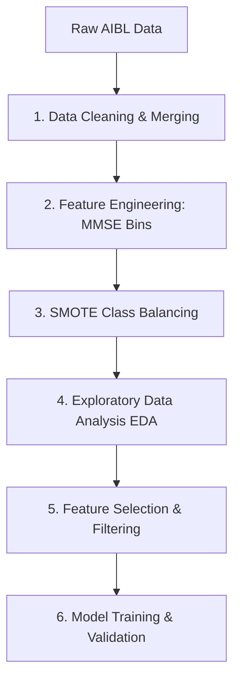

# 
🧠 Alzheimer's Diagnosis Classification (AIBL Study)

  
  
  
  

---

## 🌟 Project Overview

This repository contains an individual university coursework submission for the **MSc Data Science program at Ulster University**. The project applies rigorous supervised machine learning pipelines to classify participant data from the **AIBL Study (Australian Imaging, Biomarker & Lifestyle Study of Ageing)** into clinical health categories.

* **Task:** Binary classification (**Healthy Control [HC]** vs. **Non-HC**, where Mild Cognitive Impairment [MCI] and Alzheimer's Disease [AD] labels were merged into a single pathological class).
* **Core Tools & Libraries:** R (`tidyverse`, `caret`, `randomForest`, `e1071`, `kernlab`, `class`, `neuralnet`).
* **Deliverables:** 
  * `analysis.Rmd` — The complete, reproducible R Markdown source notebook.
  * `analysis-report.html` — The fully rendered output containing summary statistics, model metrics, and confusion matrices.

---

## 📊 Dataset & Feature Architecture

> ⚠️ **Data Privacy Notice:** The AIBL dataset is released under a strict data use agreement that prohibits public redistribution. Raw patient records are **not** included in this repository. All code, documentation, and summary analytics are provided strictly for academic demonstration.

The dataset comprises comprehensive participant-level health indicators, grouped into:
* **Demographics:** Age and Gender.
* **Medical History Flags:** Psychiatric, neurological, cardiac, hepatic, muscular, endocrine, gastric, renal, smoking, and malignancy flags.
* **Genotype Markers & Blood Biomarkers:** Key genomic and serum clinical markers.
* **Cognitive Scores:** MMSE (Mini-Mental State Examination) and logical memory assessments.

---

## 🛠️ End-to-End Machine Learning Pipeline

### Pipeline Steps:

1. **Preprocessing & Cleaning:**
   * Merged Mild Cognitive Impairment (MCI) and Alzheimer's Disease (AD) labels into a single, unified "Non-HC" category to streamline diagnostic binary prediction.
   * Removed duplicate entries, stripped redundant variables, and systematically handled missing values.

2. **Feature Engineering:**
   * Transformed raw continuous MMSE (Mini-Mental State Examination) cognitive scores into clear clinical severity bins (*severe / modest / early / normal*) to effectively capture non-linear degradation boundaries.

3. **Class Balancing:**
   * Applied **SMOTE** (Synthetic Minority Over-sampling Technique via Weka) to successfully resolve class imbalance across diagnosis groups.

4. **Exploratory Data Analysis (EDA):**
   * Visualized multi-feature distributions via group boxplots (`boxplot.png`) and verified class balance correction (`smote-result.png`).

5. **Feature Selection & Dimensionality Reduction:**
   * Combined **Recursive Feature Elimination (RFE)** using Random Forest with correlation-based filtering (cutoff threshold set at $0.5$) to eliminate multi-collinearity and redundancy.

6. **Model Training & Validation:**
   * Implemented a **70/30 stratified train/test split**.
   * Applied robust feature scaling to normalize continuous predictors prior to training three distinct classifiers:
     * **k-Nearest Neighbours** ($k = 5$)
     * **Random Forest** ($500$ decision trees)
     * **Support Vector Machine** (Radial Basis Function / RBF kernel)

---

## 📈 Model Performance Results & Evaluation

Performance metrics evaluated on the test partition demonstrate strong predictive capability across all evaluated algorithms:

| Machine Learning Model | Test Accuracy | Key Clinical & Technical Insights |
| :--- | :---: | :--- |
| 🟢 **k-Nearest Neighbours ($k=5$)** | **93.96%** | Achieved the highest overall test accuracy on the balanced feature space. |
| 🔵 **Support Vector Machine (RBF)** | **93.68%** | Highly competitive decision boundary mapping using non-linear kernel transformations. |
| 🟠 **Random Forest (500 trees)** | **88.46%** | Robust ensemble performance following recursive feature elimination and correlation filtering. |

> 💡 *Note: Detailed confusion matrices, sensitivity, specificity values, positive/negative predictive values, and 95% confidence intervals for each model are exhaustively cataloged in `analysis-report.html`.*

---
