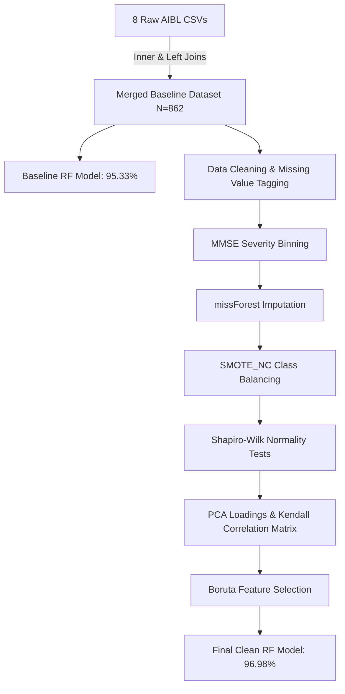

# <p align="center">🧪 Data Validation and Visualisation (AIBL Dataset)</p>

<p align="center">
  
  
  
  
</p>

---

## 🌟 Project Overview

This repository contains the coursework submission for **COM736: Data Validation and Visualisation** under the MSc Data Science program at Ulster University.

This project extends the initial diagnosis classification work from [`01-alzheimers-diagnosis-classification-aibl`](../01-alzheimers-diagnosis-classification-aibl) by building an end-to-end data integration, cleaning, missing-value imputation, class balancing, statistical validation, and feature selection pipeline directly from raw AIBL source tables.

* **Primary Objective:** Quantify the exact impact of rigorous data validation and preprocessing by comparing baseline model performance on raw merged data against a fully preprocessed, feature-selected Random Forest model.
* **Core Stack (R):** `tidyverse`, `dplyr`, `caret`, `randomForest`, `missForest`, `RSBID` (`SMOTE_NC`), `corrplot`, `Boruta`, `e1071`, `stats`.
* **Deliverables:**
  * [`report.pdf`](./report.pdf) — IEEE-formatted formal write-up detailing methodology, mathematical checks, statistical plots, and comparative results.
  * [`analysis.Rmd`](./analysis.Rmd) — Executable, fully reproducible R Markdown notebook source.

---

## 📊 Raw Data Integration & Structure

> ⚠️ **Data Privacy Notice:** The AIBL dataset is governed by a strict Data Use Agreement prohibiting public redistribution. Raw CSV files and merged data tables are **omitted from this repository**. Only code, aggregate figures, and statistical summaries are published.

The raw dataset was constructed by performing key-based relational joins across **8 distinct raw AIBL source files**:

```
├── aibl_cdr_01-Jun-2018.csv       (Clinical Dementia Rating)
├── aibl_labdata_01-Jun-2018.csv   (Blood Biomarkers & Lab Results)
├── aibl_mmse_01-Jun-2018.csv      (Mini-Mental State Examination)
├── aibl_neurobat_01-Jun-2018.csv  (Neuropsychological Battery)
├── aibl_pdxconv_01-Jun-2018.csv   (Diagnosis Conversion Records)
├── aibl_medhist_01-Jun-2018.csv  (Medical History & System Flags)
├── aibl_apoeres_01-Jun-2018.csv  (APOE Genotype Results)
└── aibl_ptdemog_01-Jun-2018.csv  (Participant Demographics)
```

### Relational Merging Logic (`analysis.Rmd`):
1. Multi-key `inner_join` on `RID`, `SITEID`, and `VISCODE` across core longitudinal tables yielding 1,688 observations.
2. Dropped redundant site/visit keys (`SITEID`, `VISCODE`) from secondary tables (`medhist`, `apoeres`, `ptdemog`).
3. Left-joined secondary tables on participant `RID`.
4. Filtered strictly for baseline records (`VISCODE == 'bl'`), fixing the dataset at **862 baseline observations**.

---

## 🛠️ Data Validation & Preprocessing Pipeline



### Detailed Pipeline Steps

1. **Baseline Benchmark Model:**
   * Trained an initial Random Forest (`ntree = 500`) directly on raw merged data using a 70/30 split prior to any cleaning or imputation.
   * **Baseline Accuracy:** `95.33%`.

2. **Cleaning & Missing Value Encoding:**
   * Stripped administrative identifiers (`RID`, `VISCODE`, `EXAMDATE`, `APTESTDT`, `PTDOB`).
   * Categorical features factorised: `PTGENDER`, `MHPSYCH`, `MH2NEURL`, `MH4CARD`, `MH6HEPAT`, `MH8MUSCL`, `MH9ENDO`, `MH10GAST`, `MH12RENA`, `MH16SMOK`, `MH17MALI`, `CDGLOBAL`, `DXCURREN`.
   * Re-encoded implicit placeholder missing flags (`-4` and invalid target code `7`) to `NA`.
   * Re-mapped target label `DXCURREN == 1` to `"HC"` and all other pathological states to `"Non-HC"`.
   * Deduplicated identical rows via `dplyr::distinct()`.

3. **Feature Engineering (MMSE Severity Binning):**
   * Categorized continuous Mini-Mental State Examination (`MMSCORE`) into clinical severity groups:
     * $\le 10 \rightarrow$ **Severe**
     * $11 - 20 \rightarrow$ **Modest**
     * $21 - 24 \rightarrow$ **Early**
     * $25 - 30 \rightarrow$ **Normal**

4. **Iterative Non-Parametric Imputation (`missForest`):**
   * Imputed missing continuous and categorical values simultaneously using Random Forest imputation (`missForest`), producing complete, realistic features without distorting non-linear underlying relationships.
   * Evaluated distribution shift pre/post imputation using faceted `ggplot2` boxplots.

5. **Mixed-Data Synthetic Oversampling (`RSBID::SMOTE_NC`):**
   * Applied Nominal Continuous SMOTE (`SMOTE_NC`, target index column `31`) to overcome target class imbalance between `HC` and `Non-HC` groups.

6. **Statistical Distribution Checks:**
   * Conducted **Shapiro-Wilk normality tests** (`shapiro.test`) across all numerical features post-balancing.
   * Confirmed pervasive non-normality ($p < 0.05$), validating the necessity of non-parametric correlation metrics and tree-based modeling.

7. **Dimensionality Reduction & Feature Selection:**
   * **Principal Component Analysis (PCA):** Calculated explained variance ratios and feature loadings matrix (`prcomp`) on standardized data.
   * **Kendall Rank Correlation:** Plotted non-parametric Kendall correlation matrix (`corrplot`) to identify collinear feature clusters.
   * **Boruta Algorithm:** Executed shadow-attribute feature selection (`Boruta(DXCURREN ~ ., ntree = 500)`) to retain only statistically confirmed relevant features.

8. **Final Optimized Model Evaluation:**
   * Retrained Random Forest (`ntree = 500`) on the 70/30 stratified train/test partition using only Boruta-confirmed attributes.

---

## 📈 Model Performance Comparison

Comparing performance before vs. after full data validation, cleaning, imputation, and feature selection:

| Model Configuration | Data State | Test Accuracy | Improvement |
| :--- | :--- | :---: | :---: |
| 🔴 **Baseline Random Forest** | Raw, uncleaned merged data | **95.33%** | Benchmark |
| 🟢 **Final Optimized Random Forest** | Processed, `missForest` imputed, `SMOTE_NC` balanced, `Boruta` selected | **96.98%** | **+1.65%** |

---

## 📂 Repository Structure

```
.
├── analysis.Rmd     # Full reproducible R Markdown script (data integration, missForest, Boruta, RF)
├── report.pdf       # Formal IEEE-style academic report detailing equations, plots, and evaluation
└── README.md        # Folder documentation
```

---

## 📜 Academic Integrity & Usage Notice
* Developed as an individual academic submission for **Ulster University (COM736)**. All code and report analyses are original.
* Access to underlying raw AIBL data must be requested separately via the official [AIBL Study access portal](https://aibl.csiro.au/).
