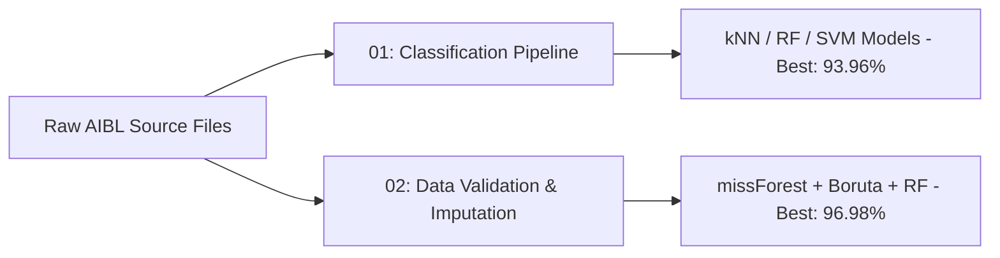

# <p align="center">🧠 Alzheimer's Diagnosis Classification (AIBL Study Portfolio)</p>

<p align="center">
  
  
  
</p>

---

## 🌟 Portfolio Overview

This subfolder houses two interconnected MSc Data Science research projects at **Ulster University** applying advanced supervised machine learning and data engineering pipelines to the **AIBL Study (Australian Imaging, Biomarker & Lifestyle Study of Ageing)**.

Both projects address the critical early diagnostic task: classifying participants into **Healthy Control (HC)** versus **Non-HC** (merging Mild Cognitive Impairment [MCI] and Alzheimer's Disease [AD] into a single pathological target state) using clinical, demographic, cognitive, and blood-based biomarker attributes.



---

## 📑 Project Summary & Comparison

| # | Project Subfolder | Core Focus & Methodology | Primary ML Techniques | Peak Test Accuracy |
| :-: | :--- | :--- | :--- | :---: |
| **01** | [`01-alzheimers-diagnosis-classification-aibl`](./01-alzheimers-diagnosis-classification-aibl) | **Multi-Classifier Evaluation**<br>Comparing algorithms on a pre-cleaned dataset structure. | `kNN`, `Random Forest`, `SVM (RBF)`, `SMOTE`, `RFE Feature Selection` | 🟢 **93.96%**<br>*(kNN, k=5)* |
| **02** | [`02-data-validation-visualisation-aibl`](./02-data-validation-visualisation-aibl) | **End-to-End Data Pipeline**<br>Multi-table integration, missing value imputation, statistical validation & selection. | `Multi-CSV Join`, `missForest`, `SMOTE-NC`, `Boruta`, `PCA`, `Kendall Correlations` | 🟢 **96.98%**<br>*(Random Forest)* |

---

## 🔗 How the Projects Interrelate

1. **Project 1 (Modelling & Evaluation Focus):** Explores classifier comparative dynamics (kNN, Random Forest, SVM) after baseline balancing (`SMOTE`) and standard feature selection (`RFE`), establishing a benchmark target accuracy of ~$94\%$.
2. **Project 2 (Data Validation & Pipeline Engineering Focus):** Takes a deeper, foundational approach by merging eight raw source tables directly. It proves that rigorous data cleaning, non-parametric imputation (`missForest`), distribution checks (Shapiro-Wilk), and shadow-attribute selection (`Boruta`) elevate model performance from **95.33%** (raw data) to **96.98%** (fully preprocessed data).

> 💡 *Recommended Reading Order: Explore **Project 01** first to understand model benchmarks, followed by **Project 02** to see the full data pipeline engineering process.*

---

## 🛠️ Technology Stack & Dependencies

* **Core Environment:** R (`R Markdown` reproducible notebooks)
* **Data Processing & Engineering:** `tidyverse`, `dplyr`, `missForest`, `RSBID` (`SMOTE_NC`)
* **Machine Learning & Feature Selection:** `caret`, `randomForest`, `e1071`, `kernlab`, `class`, `neuralnet`, `Boruta`
* **Analytics & Visualisation:** `corrplot`, `stats`, `ggplot2`

---

## 📂 Subfolder Layout

```
.
├── 01-alzheimers-diagnosis-classification-aibl/
│   ├── README.md               # Folder-level workflow documentation
│   ├── analysis.Rmd            # Source R Markdown code
│   ├── analysis-report.html    # Full rendered HTML report
│   ├── boxplot.png             # Exploratory boxplots
│   └── smote-result.png        # Class balance visualisation
│
└── 02-data-validation-visualisation-aibl/
    ├── README.md               # Folder-level pipeline documentation
    ├── analysis.Rmd            # Raw-to-model R Markdown notebook
    └── report.pdf              # IEEE-style formal academic report
```

---

## 🔒 Data Privacy & Access Notice

The AIBL dataset is restricted under a formal Data Use Agreement prohibiting public redistribution. **No raw patient records or processed tabular files are hosted in this repository.**

All code, markdown source files, rendered reports, and aggregate metrics are published strictly for academic reference and verification. Researchers seeking to run these scripts must apply for direct data access via the official [AIBL Study Access Portal](https://aibl.csiro.au/).
