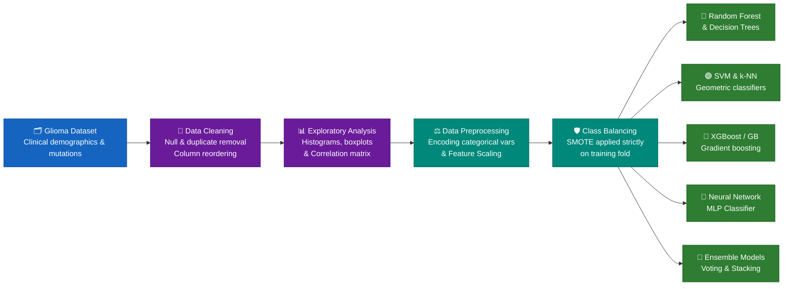

<h1 align="center">🧠 Predictive Modelling of Glioma Grade Using Machine Learning</h1>

<p align="center">
  <i>Exploratory Data Analysis, Feature Engineering & Multi-Model Classification on Clinical & Molecular Glioma Data</i>
</p>

<p align="center">
  
  
  
  
  
</p>

<p align="center">
  
  
  
</p>

---

## 🎯 At a Glance

| Metric / Attribute | Details |
| :--- | :--- |
| 🔬 **Research Question** | Can clinical demographics and genetic mutation markers accurately predict glioma grade (Low-Grade vs. Glioblastoma)? |
| 🧪 **Target Classes** | 🟢 **Low-Grade Glioma (LGG)** (486 instances) · 🔴 **Glioblastoma (GBM)** (352 instances) |
| 📦 **Data Source** | `Glioma_data.csv` — Comprehensive clinical and molecular genomic features |
| 🤖 **Models Implemented** | Random Forest · Decision Trees · Support Vector Machines (SVM) · k-NN · Gradient Boosting / XGBoost · Multi-Layer Perceptron (MLP) · Stacking & Voting Ensembles |
| 🏆 **Evaluation Focus** | Precision, Recall, F1-Score, and ROC-AUC (to handle false-positive medical constraints) |
| 📄 **Project Artifacts** | [`glioma_analysis_report.md`](./glioma_analysis_report.md) (Complete Report) · [`model_pipeline.py`](./model_pipeline.py) (Python Script) |

---

## 🔄 End-to-End Machine Learning Pipeline



---

## 📊 Exploratory Data Analysis & Statistical Findings

* **Target Distribution:** The dataset contains **486 Low-Grade Glioma (LGG)** and **352 Glioblastoma (GBM)** samples, presenting a moderate class imbalance that necessitates targeted oversampling strategies.
* **Demographic Patterns:** Analysis across `Gender` and `Race` evaluated potential demographic confounding variables against tumor grading presentation.
* **Genetic Correlations:** Correlation heatmaps across mutation markers (`IDH1`, `TP53`, `ATRX`, `PTEN`) revealed strong molecular collinearity clusters that act as powerful discriminators between LGG and GBM.

---

## 🏆 Model Architecture & Validation Strategy

The project implements a diverse set of classifiers to benchmark performance:

| Model Category | Algorithms Used | Purpose & Advantages |
| --- | --- | --- |
| **Tree-Based Models** | Decision Trees, Random Forest | Captures non-linear feature interactions and outputs feature importances. |
| **Distance & Margin Classifiers** | Support Vector Machines (SVM), k-NN | Evaluates hyperplanar separation and nearest neighbor clustering. |
| **Boosting Classifiers** | XGBoost, Gradient Boosting | Sequential residual error correction for high predictive accuracy. |
| **Neural Networks** | Multi-Layer Perceptron (MLP) | Learns intricate latent representations across molecular mutation profiles. |
| **Ensemble Models** | Voting & Stacking Classifiers | Combines diverse predictions to reduce variance and boost generalization. |

---

## ⚙️ Quick Start & Python Implementation

Here is how the data ingestion and preprocessing pipeline is structured in Python:

```python
import pandas as pd
import numpy as np
from sklearn.model_selection import train_test_split
from sklearn.preprocessing import StandardScaler
from imblearn.over_sampling import SMOTE

# 1. Load Cleaned Dataset
df = pd.read_csv('Glioma_data.csv')

# 2. Separate Features and Target
X = df.drop(columns=['Grade'])
y = df['Grade']

# 3. Stratified Train-Test Split
X_train, X_test, y_train, y_test = train_test_split(
    X, y, test_size=0.2, random_state=42, stratify=y
)

# 4. Handle Class Imbalance via SMOTE on Training Fold Only
smote = SMOTE(random_state=42)
X_train_resampled, y_train_resampled = smote.fit_resample(X_train, y_train)

print(f"Training shape after SMOTE: {X_train_resampled.shape}")

```

---

## 🚀 Future Recommendations

1. **Hyperparameter Optimization:** Integrate `GridSearchCV` or `RandomizedSearchCV` to fine-tune hyperparameters for Random Forest and XGBoost.
2. **Feature Selection:** Implement Recursive Feature Elimination (RFE) to prune noisy mutation columns and lower inference time.
3. **External Validation:** Test the finalized stacking ensemble pipeline on an independent multi-center clinical dataset.

<p align="center"><sub>Individual MSc Research Paper submission · Ulster University</sub></p>