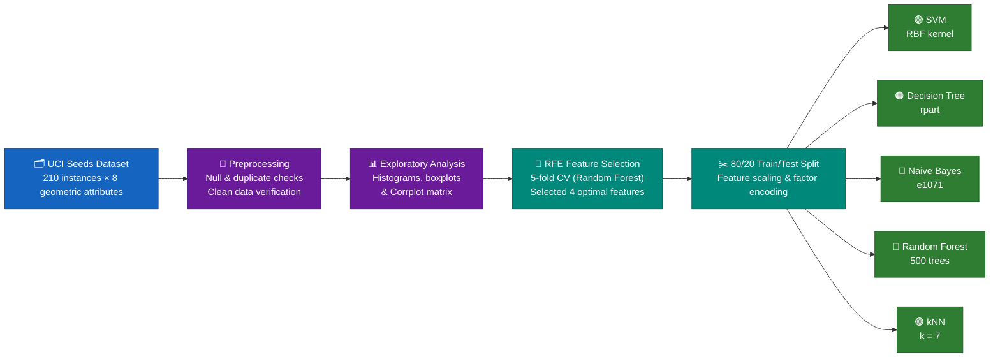

<h1 align="center">🌾 Statistical Modelling of Wheat Variety Classification</h1>

<p align="center">
  <i>Geometric Feature Analysis & Multi-Model Classification on the UCI Seeds Dataset — SVM · Decision Tree · Naive Bayes · Random Forest · kNN in R</i>
</p>

<p align="center">
  
  
  
  
  
</p>

<p align="center">
  
  
  
</p>

---

## 🎯 At a glance

| | |
|---|---|
| 🔬 **Question** | Can geometric kernel measurements accurately classify wheat varieties using statistical machine learning models? |
| 🧪 **Classes** | 🌾 **Canadian** · 🌾 **Rosa** · 🌾 **Kama** (70 instances each, perfectly balanced) |
| 📦 **Data** | UCI Seeds Dataset — 210 instances × 8 attributes (Area, Perimeter, Compactness, Length, Width, Asymmetry Coefficient, Groove Length, Variety) |
| 🤖 **Models** | Support Vector Machine (SVM) · Decision Tree (rpart) · Naive Bayes · Random Forest · k-Nearest Neighbours (kNN) |
| 🏆 **Best result** | **SVM (RBF Kernel) at 95.24% accuracy** |
| 📄 **Report** | [`analysis-report.pdf`](./analysis-report.pdf) (rendered report) · [`analysis.Rmd`](./analysis.Rmd) (R Markdown source) |

---

## 🔄 Pipeline



1. **Preprocessing** — Inspected structure, verified zero missing values, checked and removed duplicate entries.
2. **Exploratory Data Analysis** — Generated distribution histograms, outlier boxplots, and a correlation matrix (`corrplot`) showing strong collinearity among geometric properties (e.g., width & length, area & perimeter).
3. **Feature Engineering** — Applied Recursive Feature Elimination (RFE) via 5-fold cross-validation (`rfeControl` with `rfFuncs`) to distill the attribute set down to the 4 most discriminative features: `Length_Kernel_Groove`, `Area`, `Perimeter`, and `Asymmetry_Coefficient`.
4. **Modelling & Evaluation** — Performed an 80/20 train/test split, scaled features, and benchmarked five classification algorithms using confusion matrices.

### 🧬 Features selected by RFE (4)

| Feature | Description |
| --- | --- |
| `Length_Kernel_Groove` | Length of the kernel groove (mm) |
| `Area` | Area of the wheat kernel ($\text{mm}^2$) |
| `Perimeter` | Perimeter of the kernel (mm) |
| `Asymmetry_Coefficient` | Characterizes kernel asymmetry |

---

## 🏁 Results

### Test-set performance comparison

| Rank | Model | R Package | Accuracy | Key Performance Notes |
| --- | --- | --- | --- | --- |
| 🥇 | **SVM (RBF Kernel)** | `kernlab` |  | Outperformed all models; exceptional handling of nonlinear class boundaries. |
| 🥈 | **Decision Tree** | `rpart` |  | High interpretability with clear decision rules and tree splits. |
| 🥉 | **Naive Bayes** | `e1071` |  | Robust probabilistic classification assuming conditional independence. |
| 4 | **Random Forest** | `randomForest` |  | Strong ensemble performance with 500 trees. |
| 5 | **kNN ($k=7$)** | `class` |  | Proximity-based classification; solid baseline performance. |

---

## 💡 Key Takeaways

* **SVM Emerges as Top Performer:** Achieving **95.24% accuracy**, Support Vector Machines with an RBF kernel proved exceptionally adept at handling complex, non-linear relationships among kernel geometries.
* **Feature Selection Efficiency:** RFE successfully reduced dimensionality from 7 input features down to 4 core geometric metrics without sacrificing predictive power, confirming that groove length, area, perimeter, and asymmetry are primary drivers of variety differentiation.
* **Robustness Across Methods:** Tree-based and probabilistic models (`rpart`, Naive Bayes) also performed strongly above 92%, validating the distinct separability of the Canadian, Rosa, and Kama wheat varieties.

---

## ▶️ Reproducing

To run the analysis locally, ensure you have R installed along with the required dependencies:

```r
install.packages(c(
  "rpart", "rpart.plot", "class", "kernlab", 
  "corrplot", "caret", "randomForest", "e1071", "ggplot2"
))

```

*Note: Update the local file path in `analysis.Rmd` pointing to your copy of `seeds_dataset.txt` before running the notebook.*

---

## 📁 Folder Contents

```
Statistical Modelling of Wheat Variety Classification/
├── README.md               ← You are here
├── analysis.Rmd            ← R Markdown source code
├── analysis-report.pdf     ← Comprehensive rendered report
└── seeds_dataset.txt       ← UCI Seeds dataset (geometric attributes)

```


<p align="center"><sub>Individual MSc coursework submission · Ulster University</sub></p>